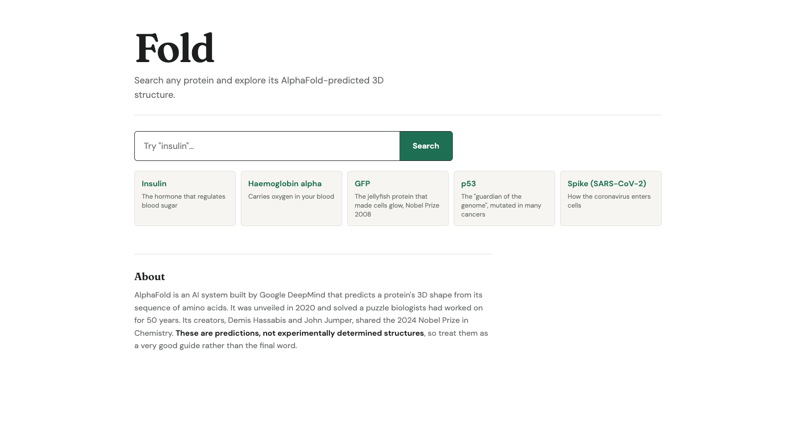
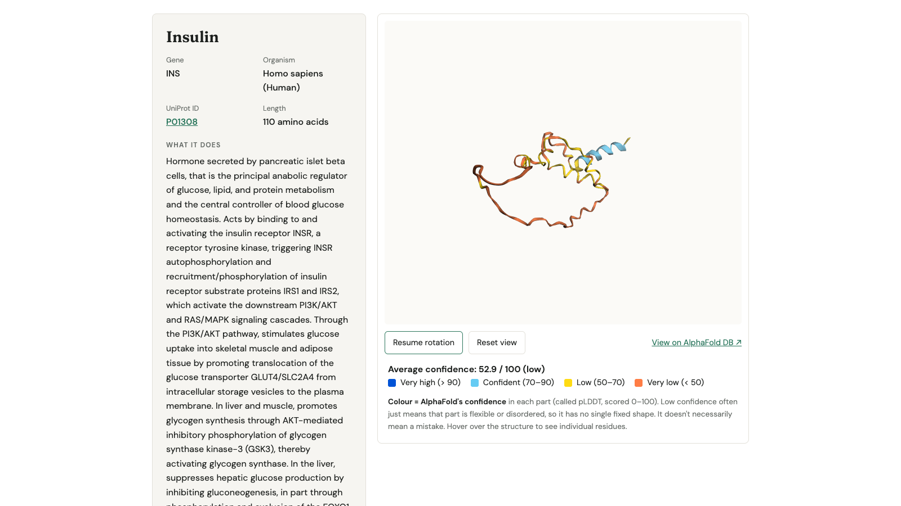
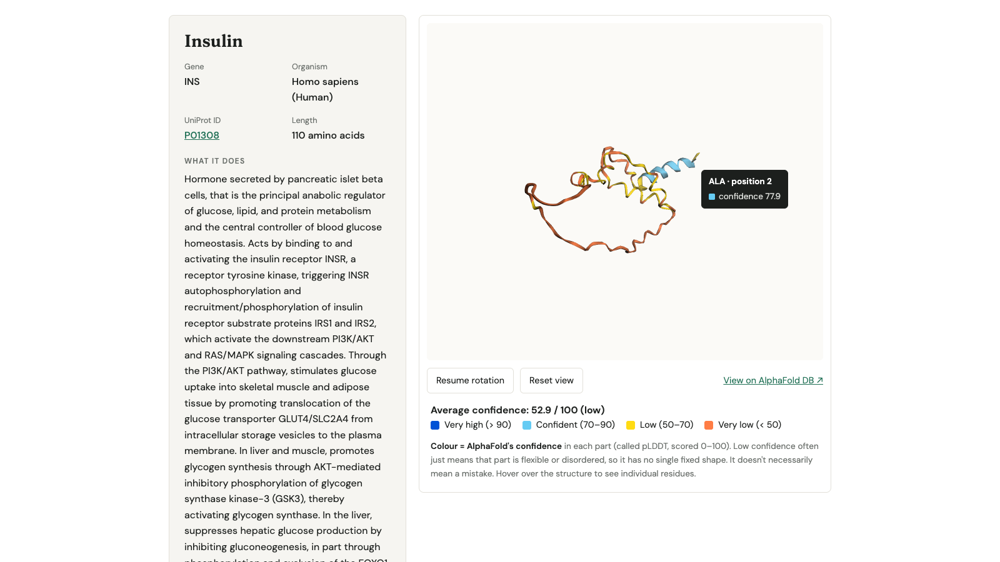
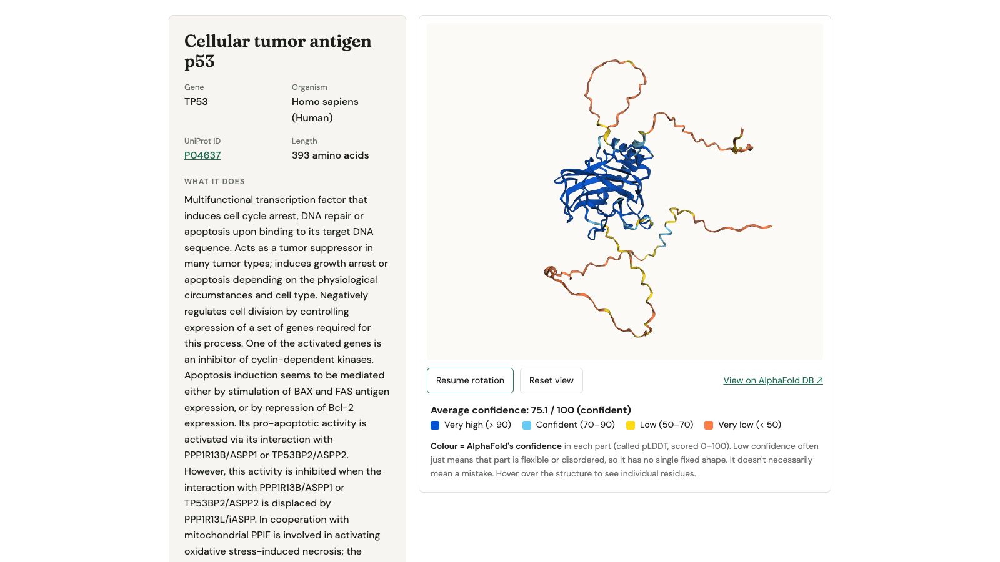
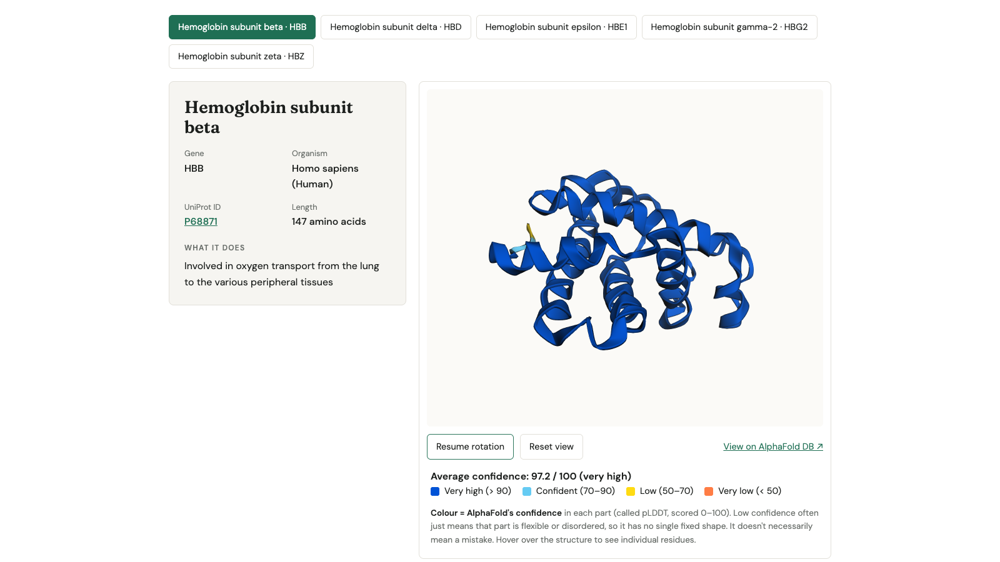
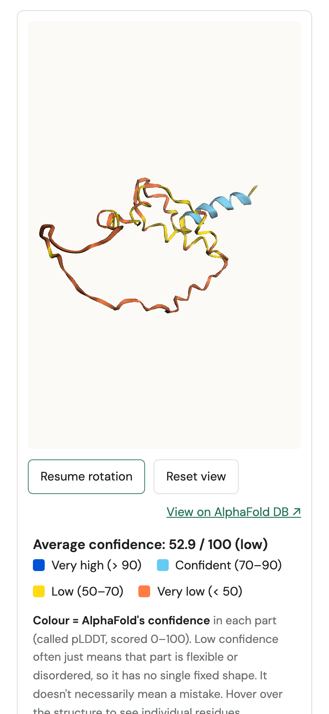
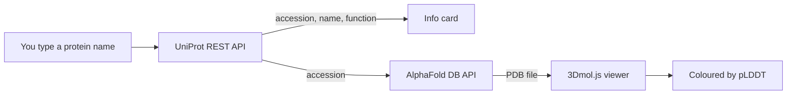

<div align="center">

# Fold

**Search any protein and explore its AlphaFold-predicted 3D structure, coloured by how confident the model is.**

[](https://github.com/aluinn/biotech-project/actions/workflows/ci.yml)
[](https://github.com/aluinn/biotech-project/actions/workflows/codeql.yml)
[](LICENSE)
[](https://github.com/aluinn/biotech-project/stargazers)

[](https://vercel.com/new/clone?repository-url=https%3A%2F%2Fgithub.com%2Faluinn%2Fbiotech-project)

https://github.com/user-attachments/assets/b71fb34d-34e9-43d4-a540-8ec37160ea19

[**Live demo**](https://biotech-project-six.vercel.app) · [Architecture](docs/ARCHITECTURE.md) · [Roadmap](ROADMAP.md) · [Contributing](CONTRIBUTING.md)

</div>

---

## Features

- **Search by protein or gene name.** Fold queries UniProt's reviewed (Swiss-Prot) entries and prefers human proteins, so "p53" finds TP53.
- **Up to five matches per search**, shown as buttons so you can switch between close results (e.g. the haemoglobin subunits).
- **Interactive 3D structure** rendered as a slowly rotating cartoon. Drag to rotate, scroll to zoom, pause the rotation or reset the view.
- **Colour by AlphaFold's confidence (pLDDT)** using AlphaFold's standard four-colour scheme, plus the average confidence across the whole protein.
- **Residue inspector.** Hover (mouse) or tap (touch screens) a residue to see its amino acid, position and confidence score.
- **Plain-English summary** of what the protein does, taken from UniProt with citation clutter stripped out.
- **Five one-click examples:** insulin, haemoglobin alpha, GFP, p53 and the SARS-CoV-2 spike.
- **Works on phones.** The layout stacks on narrow screens.
- **No backend, no build step, no API key.** It is a few static files that talk directly to public APIs.

## Screenshots

| | |
|---|---|
|  |  |
| **Home.** Search box and one-click examples. | **Insulin (P01308).** Mostly low-confidence regions. |
|  |  |
| **Residue inspector.** Hover to see one amino acid. | **p53 (P04637).** Confident core, flexible tails. |

<details>
<summary>More screenshots</summary>

| | |
|---|---|
|  |  |
| **Several matches.** Searching "hemoglobin" returns five subunits. | **Phone (390 × 844).** The viewer and legend stack vertically. |

</details>

## How it works



1. **Find the protein.** The app searches the [UniProt REST API](https://rest.uniprot.org) for reviewed entries, human first. It reads the name, gene, organism, sequence length, function text and accession ID.
2. **Get the structure.** With the accession, it asks the [AlphaFold Protein Structure Database API](https://alphafold.ebi.ac.uk/api-docs) for the prediction and downloads the PDB file it points to.
3. **Draw it.** [3Dmol.js](https://3dmol.org) renders the structure as a cartoon.
4. **Colour by confidence.** AlphaFold stores its per-residue confidence (pLDDT, 0–100) in the PDB "B-factor" column. Fold colours each residue with AlphaFold's standard scheme:

   | pLDDT | Meaning | Colour |
   |---|---|---|
   | > 90 | Very high | Dark blue |
   | 70–90 | Confident | Light blue |
   | 50–70 | Low | Yellow |
   | < 50 | Very low | Orange |

   Low confidence often means a flexible or disordered region, not necessarily a mistake. The average shown is the mean across one backbone atom per residue.

See [docs/ARCHITECTURE.md](docs/ARCHITECTURE.md) for the full data flow, failure modes and design decisions.

## Quick start

Requires [Node.js](https://nodejs.org) 20 or newer for the helper scripts. The app itself needs nothing but a static file server and an internet connection.

```bash
git clone https://github.com/aluinn/biotech-project.git
cd biotech-project
npm install      # only needed for screenshots and tests
npm start        # http://localhost:8000
```

Any static server works too, for example `python3 -m http.server`.

| Command | What it does |
|---|---|
| `npm start` | Serves the app at `http://localhost:8000` (pass a different port with `node scripts/serve.mjs 3000`) |
| `npm test` | Runs the unit tests (Node's built-in test runner, no network) |
| `npm run check` | Syntax-checks every JavaScript file |
| `npm run test:e2e` | Runs the browser smoke tests with Playwright (APIs are mocked) |
| `npm run screenshots` | Regenerates the README screenshots with your installed Google Chrome (needs network) |
| `npm run benchmark` | Measures fetch and render times (see [docs/PERFORMANCE.md](docs/PERFORMANCE.md)) |

## Deploy

Fold is plain static files, so it deploys anywhere that serves a folder. The live demo is hosted on Vercel.

- **Vercel:** click the deploy button above, or import the repository and leave the build command and output directory empty.
- **Anywhere else** (GitHub Pages, Netlify, Cloudflare Pages, S3): publish the repository root.

## FAQ

**Are these structures real?**
They are predictions from AlphaFold, not experimentally determined structures. Treat them as a very good guide, not the final word. Check the confidence colours before trusting any region.

**Why is part of my protein orange?**
Orange means pLDDT below 50. That usually marks a flexible or disordered stretch with no single fixed shape (see the long tails on p53), not necessarily an error.

**Why does a search say "AlphaFold has no predicted structure"?**
UniProt knows the protein but AlphaFold DB returned a 404 for that accession. Try another match from the list or one of the examples.

**Why "haemoglobin" and "hemoglobin" both work?**
UniProt uses the American spelling, so Fold rewrites "haemo" to "hemo" before searching. It is the only spelling rewrite in the code.

**What are the limitations?**
- Only reviewed (Swiss-Prot) entries are searched, and at most five matches are shown.
- Fold draws the first model AlphaFold DB returns for an accession. It does not show alternative models, mutations, ligands or protein complexes.
- It depends on three third-party services (UniProt, AlphaFold DB, and the cdnjs-hosted 3Dmol.js) plus Google Fonts. If one is down, that part of the app fails with an error message.
- There is no offline mode and no result caching.

**Is it for clinical or research use?**
No. It is an educational viewer.

## Good first issues

Each draft in [docs/issues](docs/issues) has context, a task, acceptance criteria and pointers to the code. Copy one into a new GitHub issue to claim it.

| Issue | Label |
|---|---|
| [Add a Subresource Integrity hash to the 3Dmol.js script tag](docs/issues/01-add-sri-to-3dmol-script.md) | good first issue |
| [Build the residue tooltip with DOM nodes instead of `innerHTML`](docs/issues/02-replace-innerhtml-in-tooltip.md) | good first issue |
| [Show a clear message if 3Dmol.js fails to load](docs/issues/03-show-message-when-3dmol-fails-to-load.md) | good first issue |
| [Expose the selected match to screen readers with `aria-pressed`](docs/issues/04-mark-selected-match-for-screen-readers.md) | good first issue |
| [Add a "Download PDB" link](docs/issues/05-add-download-pdb-button.md) | good first issue |
| [Run the two UniProt searches in parallel](docs/issues/06-run-uniprot-queries-in-parallel.md) | enhancement |
| [Support shareable links (`?q=`, `?acc=`)](docs/issues/07-shareable-links.md) | enhancement |
| [Cache protein data and structures for the session](docs/issues/08-cache-api-results-per-session.md) | enhancement |
| [Show AlphaFold's predicted aligned error (PAE) image](docs/issues/09-show-predicted-aligned-error.md) | enhancement |
| [Add an organism filter to search](docs/issues/10-organism-filter.md) | enhancement |

## Roadmap

See [ROADMAP.md](ROADMAP.md).

## Credits

Built by [Aluinn McDonald](https://github.com/aluinn).

- [UniProt](https://www.uniprot.org): protein names, functions and accession IDs
- [AlphaFold Protein Structure Database](https://alphafold.ebi.ac.uk): predicted structures. AlphaFold is by [Google DeepMind](https://deepmind.google), and the database is a collaboration with [EMBL-EBI](https://www.ebi.ac.uk)
- [3Dmol.js](https://3dmol.org): in-browser 3D molecular viewer
- [Fraunces](https://fonts.google.com/specimen/Fraunces) and [DM Sans](https://fonts.google.com/specimen/DM+Sans) via Google Fonts
- [Playwright](https://playwright.dev): screenshots

## Licence

[MIT](LICENSE) © Aluinn McDonald
