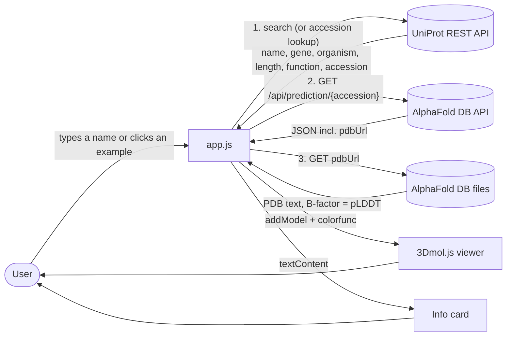
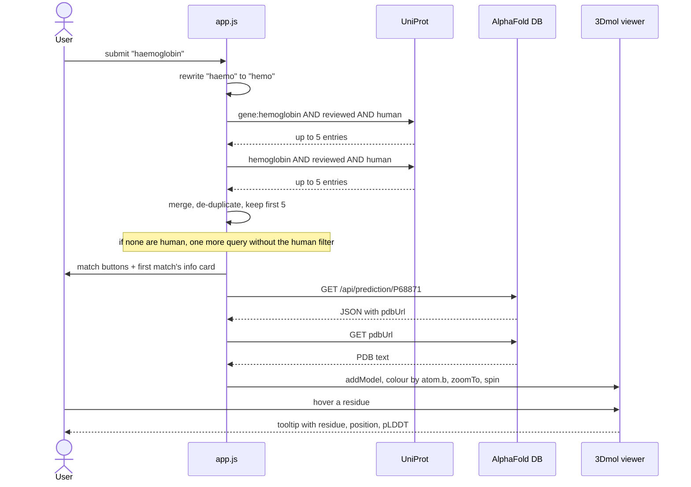

# Architecture

Fold is three static files (`index.html`, `style.css`, `app.js`) that call two public APIs directly from the browser. There is no server, no build step and no stored state.

## Data flow



Both APIs send `access-control-allow-origin: *`, which is what makes a backend-free design possible. 3Dmol.js comes from cdnjs, fonts from Google Fonts.

## Key sequence: searching for a protein



Example buttons skip the search: they carry a UniProt accession in `data-accession` and go straight to an `accession:` query.

## Folder map

```
.
├── index.html              Page structure, example buttons, confidence legend
├── style.css               Theme (CSS variables) and responsive layout
├── app.js                  Search, data fetching, viewer, colouring, tooltips
├── scripts/
│   ├── serve.mjs           Zero-dependency static server (npm start)
│   ├── capture-screenshots.mjs   Generates docs/assets/*.png with Chrome
│   └── benchmark.mjs       Measures the numbers in docs/PERFORMANCE.md
├── docs/
│   ├── ARCHITECTURE.md     This file
│   ├── DATA_SOURCES.md     What is read from each API
│   ├── PERFORMANCE.md      Measured latencies
│   ├── CONFIDENCE.md       What pLDDT means and how Fold shows it
│   ├── assets/             Screenshots and other media
│   └── issues/             Drafted issues
└── .github/                CI, issue and PR templates, Dependabot
```

## Failure modes

| What goes wrong | What the user sees | Where handled |
|---|---|---|
| UniProt returns a non-2xx status or the request fails | Red status message: "Couldn't reach the protein database…" | `runSearch` catch |
| UniProt finds nothing | Status message suggesting a simpler name | `runSearch` |
| AlphaFold has no model (HTTP 404) | Info card shows, viewer says there is no predicted structure and to try another match | `loadStructure` |
| AlphaFold API or file download fails (other status, network) | Viewer message "Couldn't load the 3D structure…" | `loadStructure` catch |
| User clicks a second protein while the first is loading | Only the latest result is drawn (older responses are dropped) | `loadCounter` |
| 3Dmol.js fails to load from the CDN | Info card appears but the viewer does not. `$3Dmol` is undefined, so `loadStructure` rejects before its `try` block. Nothing awaits that promise, so no message is shown (unhandled rejection in the console) | **Not handled** |
| Google Fonts blocked | System fonts are used (the CSS has fallbacks) | `style.css` |
| Empty search box | Nothing happens | `runSearch` |
| Protein has no FUNCTION comment in UniProt | "No function description is available for this protein yet." | `getFunctionText` |
| Touch device (no hover) | Tap a residue instead of hovering | `setupHover` |

## Decisions and trade-offs

**No backend.** Both APIs allow cross-origin requests, so the browser can talk to them directly. That keeps hosting free, removes secrets and makes the project easy to fork. The cost is that Fold has no cache, no rate limiting and no control over upstream outages.

**Follow `pdbUrl` rather than building the file URL.** The code reads `pdbUrl` from the prediction JSON instead of constructing `AF-{accession}-F1-model_v{n}.pdb`. File names include a model version (currently `v6`), so following the API avoids breaking when AlphaFold DB releases a new version.

**Read pLDDT from the B-factor column.** AlphaFold writes its per-residue confidence into the PDB B-factor field, and 3Dmol exposes it as `atom.b`. That means no second file (such as the confidence JSON) has to be downloaded.

**Custom `colorfunc` instead of a built-in 3Dmol scheme.** The viewer colours each atom with AlphaFold's own four-colour scheme through `colorfunc`, so the legend in the page matches the AlphaFold DB website.

**Average over C-alpha atoms only.** The "average confidence" counts one `CA` atom per residue so every residue weighs the same. For insulin it gives 52.9, which equals the `globalMetricValue` the API reports (52.91).

**Two sequential UniProt queries per text search.** Matches on the *gene* name are listed first (so "p53" gives TP53 rather than something that merely mentions p53), then general text matches. The queries run one after the other, which costs about 270 ms in total (see [PERFORMANCE.md](PERFORMANCE.md)). Running them in parallel would cut the wait to about the slower of the two (not measured) and is a good candidate for a follow-up.

**Human first, then any reviewed entry.** Only if the human searches return nothing does the app fall back to all reviewed (Swiss-Prot) entries. This favours the proteins most visitors mean, at the price of hiding non-human proteins that share a name with a human one.

**User text goes into UniProt's query language.** The text is URL-encoded but not otherwise escaped, so UniProt syntax (quotes, `AND`, field names) passes through. That is convenient for power users and harmless for a read-only public API, but it can produce surprising results for ordinary input containing special characters.

**First model only.** The code uses `info[0]`. The API returned a one-element array for insulin (the only protein checked by hand), so this works for the examples, but any additional entries the API might return are ignored.

**Pause rotation while inspecting.** The spin stops while you hover a residue and restarts 400 ms after the pointer leaves, so the residue doesn't slide out from under the cursor.
